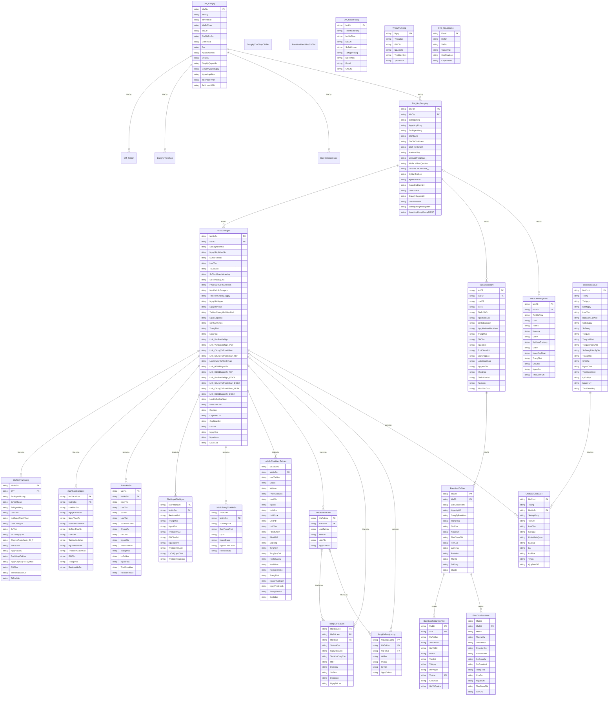
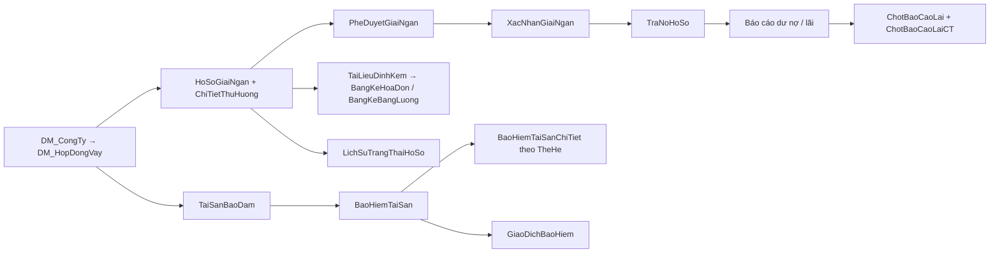

# Luồng dữ liệu HAK VAY

> **Tài liệu SINH TỰ ĐỘNG từ mã nguồn** bằng `node tools/sinh_luong_du_lieu.cjs` — không sửa tay. Bộ kiểm thử `chay_quan_he_du_lieu` báo lỗi nếu tài liệu lệch mã.
> Nguồn sự thật: `SO_DO_DU_LIEU_` (QUANHEDULIEU.gs), cột thật do `initializeSpreadsheet`, `bangQuyenApi_` (PHIEN.gs), `CHUYEN_TRANG_THAI_` (HOSODOMAIN.gs).
> Phương pháp: skill `hak-data-integrity` + `hak-parent-child-data-model` (kho hak_ai_skills). Chưa kiểm chứng trên Google Sheets thật (chỉ bộ giả lập); không chứa dữ liệu vận hành.

## 1. Sơ đồ quan hệ (ERD)



`|o--o{` = khoá ngoại được phép để trống. Bảng không có khoá chính (nhật ký/dấu vết) chỉ thêm dòng.

## 2. Luồng nghiệp vụ chính



## 3. Vòng đời hồ sơ (trạng thái hợp lệ)

```mermaid
stateDiagram-v2
  [*] --> "Nháp"
  "Nháp" --> "Đã tạo hồ sơ"
  "Đã tạo hồ sơ" --> "Nháp"
  "Đã tạo hồ sơ" --> "Đã giải ngân"
  "Đã giải ngân" --> "Đã hủy"
```

Chỉ hồ sơ **Đã giải ngân** tính vào dư nợ. Chuyển trạng thái ngoài bảng trên bị từ chối ở máy chủ.

## 4. Từ điển dữ liệu

### DM_TaiSan — Danh mục tài sản mới

- Khoá chính: `Ma, Revision`
- Khoá ngoại: `MaCty` → `DM_CongTy` (Công ty quản lý, khác chủ sở hữu)
- Ghi bởi: `luuDanhMucTaiSan`, `doiTrangThaiTaiSanDanhMuc`
- Xoá: Không xóa; giữ lịch sử phiên bản
- Chống trùng: Khóa yêu cầu; kiểm liên kết MaTaiSan trong ts2KiemTraQuanHe_
- Phiên bản/đồng thời: Revision + expectedRevision; chỉ thêm dòng; chi tiết theo Phien
- Cột (0): —

### DangKyTheChap — Danh mục tài sản mới

- Khoá chính: `Ma, Revision`
- Khoá ngoại: `MaCty` → `DM_CongTy` (Công ty quản lý, khác chủ sở hữu)
- Ghi bởi: `luuDangKyTheChap`, `doiTrangThaiTaiSanDanhMuc`
- Xoá: Không xóa; giữ lịch sử phiên bản
- Chống trùng: Khóa yêu cầu; kiểm liên kết MaTaiSan trong ts2KiemTraQuanHe_
- Phiên bản/đồng thời: Revision + expectedRevision; chỉ thêm dòng; chi tiết theo Phien
- Cột (0): —

### BaoHiemDanhMuc — Danh mục tài sản mới

- Khoá chính: `Ma, Revision`
- Khoá ngoại: `MaCty` → `DM_CongTy` (Công ty quản lý, khác chủ sở hữu)
- Ghi bởi: `luuBaoHiemDanhMuc`, `doiTrangThaiTaiSanDanhMuc`
- Xoá: Không xóa; giữ lịch sử phiên bản
- Chống trùng: Khóa yêu cầu; kiểm liên kết MaTaiSan trong ts2KiemTraQuanHe_
- Phiên bản/đồng thời: Revision + expectedRevision; chỉ thêm dòng; chi tiết theo Phien
- Cột (0): —

### DangKyTheChapChiTiet — Danh mục tài sản mới

- Khoá chính: `MaCha, Phien, STT`
- Khoá ngoại: —
- Ghi bởi: `luuDangKyTheChap`, `doiTrangThaiTaiSanDanhMuc`
- Xoá: Không xóa; giữ lịch sử phiên bản
- Chống trùng: Khóa yêu cầu; kiểm liên kết MaTaiSan trong ts2KiemTraQuanHe_
- Phiên bản/đồng thời: Theo Phien của cha; MaTaiSan tham chiếu mã danh mục
- Cột (0): —

### BaoHiemDanhMucChiTiet — Danh mục tài sản mới

- Khoá chính: `MaCha, Phien, STT`
- Khoá ngoại: —
- Ghi bởi: `luuBaoHiemDanhMuc`, `doiTrangThaiTaiSanDanhMuc`
- Xoá: Không xóa; giữ lịch sử phiên bản
- Chống trùng: Khóa yêu cầu; kiểm liên kết MaTaiSan trong ts2KiemTraQuanHe_
- Phiên bản/đồng thời: Theo Phien của cha; MaTaiSan tham chiếu mã danh mục
- Cột (0): —

### DM_CongTy — Danh mục

- Khoá chính: `MaCty`
- Khoá ngoại: —
- Ghi bởi: `luuCongTy`
- Xoá: Không có chức năng xoá (chỉ sửa)
- Chống trùng: Hệ thống một công ty; sửa theo đúng mã
- Phiên bản/đồng thời: Revision + expectedRevision (bắt buộc khi sửa)
- Cột (15): `MaCty` `TenCty` `TenVietTat` `MaSoThue` `MaCIF` `DiaChiTruSo` `DienThoai` `Fax` `NguoiDaiDien` `ChucVu` `GiayUyQuyenSo` `GiayUyQuyenNgay` `NguoiLapBieu` `TaiKhoanVND` `TaiKhoanUSD`

### DM_HopDongVay — Danh mục

- Khoá chính: `MaHD`
- Khoá ngoại: `MaCty` → `DM_CongTy` (công ty vay vốn)
- Ghi bởi: `luuHopDong`, `xoaHopDong`
- Xoá: Chỉ xoá khi chưa có hồ sơ/tài sản tham chiếu (RESTRICT)
- Chống trùng: Không trùng số hợp đồng trong cùng công ty
- Phiên bản/đồng thời: Revision + expectedRevision
- Cột (20): `MaHD` `MaCty` `SoHopDong` `NgayHopDong` `TenNganHang` `ChiNhanh` `DiaChiChiNhanh` `MST_ChiNhanh` `HanMucVay` `LaiSuatTrongHan_%` `MoTaLaiSuatQuaHan` `LaiSuatLaiChamTra_%` `KyHanTraGoc` `KyHanTraLai` `NguoiDaiDienNH` `ChucVuNH` `GiayUyQuyenNH` `DienThoaiNH` `SoHopDongKhungMBNT` `NgayHopDongKhungMBNT`

### DM_KhachHang — Danh mục

- Khoá chính: `MaKH`
- Khoá ngoại: —
- Ghi bởi: `luuKhachHang`, `upsertKhachHangTheoMST_ (OCR)`, `themCongTyBaoHiem_`
- Xoá: xoaKhachHang: quản trị, kiểm tra phiên bản; chặn khi dùng trong thụ hưởng hoặc bảo hiểm
- Chống trùng: khoaYeuCau khi tạo (gửi lại không tạo bản trùng); OCR theo MST
- Phiên bản/đồng thời: Revision + expectedRevision (bắt buộc khi sửa/xóa)
- Cột (9): `MaKH` `TenKhachHang` `MaSoThue` `DiaChi` `SoTaiKhoan` `TaiNganHang` `DienThoai` `Email` `GhiChu`

### HoSoGiaiNgan — Giải ngân (CHA)

- Khoá chính: `MaHoSo`
- Khoá ngoại: `MaHD` → `DM_HopDongVay` (hợp đồng Đang hiệu lực)
- Ghi bởi: `luuHoSoGiaiNgan`, `chuyenHoSoVeNhap`, `taoTronBoTheoMau`, `xacNhanGiaiNganThucTe`, `capNhatTatToanHoSo`, `xoaHoSo`
- Xoá: Xoá mềm (DaXoa), giữ lịch sử
- Chống trùng: khoaYeuCau khi tạo
- Phiên bản/đồng thời: Revision + expectedRevision (bắt buộc)
- Cột (39): `MaHoSo` `MaHD` `SoGiayNhanNo` `NgayGiayNhanNo` `DuNoHienTai` `LoaiTien` `TyGiaBan` `SoTienNhanNoLanNay` `SoTienBangChu` `PhuongThucThanhToan` `MucDichSuDungVon` `ThoiHanChoVay_Ngay` `NgayGiaiNgan` `NgayDenHan` `TaiLieuChungMinhMucDich` `NguoiLapBieu` `SoThamChieu` `TrangThai` `NgayTao` `Link_VanBanDeNghi` `Link_VanBanDeNghi_PDF` `Link_ChungTuThanhToan` `Link_ChungTuThanhToan_PDF` `LoaiChungTuThanhToan` `Link_HDMBNgoaiTe` `Link_HDMBNgoaiTe_PDF` `Link_VanBanDeNghi_DOCX` `Link_ChungTuThanhToan_DOCX` `Link_ChungTuThanhToan_XLSX` `Link_HDMBNgoaiTe_DOCX` `LoaiHoSoGiaiNgan` `KhoaYeuCau` `Revision` `CapNhatLuc` `CapNhatBoi` `DaXoa` `NgayXoa` `NguoiXoa` `LyDoXoa`

### ChiTietThuHuong — Giải ngân (CON)

- Khoá chính: `MaHoSo, STT`
- Khoá ngoại: `MaHoSo` → `HoSoGiaiNgan` (hồ sơ cha)
- Ghi bởi: `luuHoSoGiaiNgan (cùng lần ghi với cha; có nhật ký ghi dở để phục hồi)`
- Xoá: Giữ cùng hồ sơ cha (xoá mềm cha)
- Chống trùng: Theo hồ sơ cha
- Phiên bản/đồng thời: Theo Revision của hồ sơ cha
- Cột (18): `MaHoSo` `STT` `TenNguoiHuong` `SoTaiKhoan` `TaiNganHang` `LoaiTien` `NoiDungThanhToan` `LoaiChungTu` `SoTien` `SoTienQuyDoi` `ChuyenTienNhanh_24_7` `TaiLieuSo` `NgayTaiLieu` `DonViLapTaiLieu` `NgayCapGiayToTuyThan` `GhiChu` `TkTrichNoCheDo` `TkTrichNo`

### XacNhanGiaiNgan — Giải ngân thực tế

- Khoá chính: `MaXacNhan`
- Khoá ngoại: `MaHoSo` → `HoSoGiaiNgan` (hồ sơ)
- Ghi bởi: `xacNhanGiaiNganThucTe`, `ghiNhanDieuChinhGiaiNgan`, `huyGiaiNgan`
- Xoá: Không xoá; hủy bỏ bằng trạng thái
- Chống trùng: Một xác nhận hiệu lực/hồ sơ; số tham chiếu NH không trùng
- Phiên bản/đồng thời: Theo Revision hồ sơ
- Cột (14): `MaXacNhan` `MaHoSo` `LoaiBanGhi` `NgayKeHoach` `NgayThucTe` `SoThamChieuNH` `SoTienThucTe` `LoaiTien` `TaiLieuXacNhan` `NguoiXacNhan` `ThoiDiemXacNhan` `GhiChu` `TrangThai` `RevisionHoSo`

### TraNoHoSo — Trả nợ

- Khoá chính: `MaTra`
- Khoá ngoại: `MaHoSo` → `HoSoGiaiNgan` (khoản vay)
- Ghi bởi: `ghiNhanTraNo`, `ghiNhanTraNoGop`, `huyTraNo`
- Xoá: Không xoá; hủy bỏ kèm lý do
- Chống trùng: Số tham chiếu giao dịch NH không trùng
- Phiên bản/đồng thời: Theo Revision hồ sơ (bắt buộc)
- Cột (16): `MaTra` `MaHoSo` `NgayTra` `LoaiTra` `SoTien` `LoaiTien` `SoThamChieu` `ChungTu` `GhiChu` `NguoiGhi` `ThoiDiemGhi` `TrangThai` `LyDoHuy` `NguoiHuy` `ThoiDiemHuy` `RevisionHoSo`

### PheDuyetGiaiNgan — Duyệt

- Khoá chính: `MaPheDuyet`
- Khoá ngoại: `MaHoSo` → `HoSoGiaiNgan` (hồ sơ)
- Ghi bởi: `guiPheDuyet`, `quyetDinhPheDuyet`
- Xoá: Không xoá
- Chống trùng: Gắn RevisionGui
- Phiên bản/đồng thời: RevisionGui = Revision hồ sơ lúc gửi
- Cột (11): `MaPheDuyet` `MaHoSo` `RevisionGui` `TrangThai` `NguoiGui` `ThoiDiemGui` `GhiChuGui` `NguoiDuyet` `ThoiDiemDuyet` `LyDoQuyetDinh` `ThoiDiemSuDung`

### LichSuTrangThaiHoSo — Nhật ký

- Khoá chính: *(không có — chỉ thêm dòng)*
- Khoá ngoại: `MaHoSo` → `HoSoGiaiNgan` (hồ sơ)
- Ghi bởi: `chuyenTrangThaiHoSo_`
- Xoá: Chỉ thêm dòng
- Chống trùng: —
- Phiên bản/đồng thời: —
- Cột (8): `ThoiGian` `MaHoSo` `TuTrangThai` `DenTrangThai` `LyDo` `NguoiDung` `NguonDinhDanh` `RevisionSau`

### LichSuPhatHanhTaiLieu — Chứng từ

- Khoá chính: *(không có — chỉ thêm dòng)*
- Khoá ngoại: `MaHoSo` → `HoSoGiaiNgan` (hồ sơ)
- Ghi bởi: `taoTronBoTheoMau`, `taoChungTuThanhToan`, `taoDeNghiGiaiNganBIDV`
- Xoá: Giữ lịch sử; bản cũ đánh dấu Đã thay thế
- Chống trùng: Hash dữ liệu + hash mẫu
- Phiên bản/đồng thời: RevisionHoSo lúc phát hành
- Cột (25): `MaTaiLieu` `MaHoSo` `LoaiTaiLieu` `SoLan` `MaMau` `PhienBanMau` `LoaiFile` `Nguon` `LinkGoc` `LinkDocx` `LinkPdf` `LinkXlsx` `FileIdChinh` `FileIdPdf` `SoDong` `TongTien` `TongQuyDoi` `HashDuLieu` `HashMau` `RevisionHoSo` `TrangThai` `NguoiPhatHanh` `NgayPhatHanh` `ThongBaoLoi` `CanhBao`

### TaiLieuDinhKem — Tài liệu

- Khoá chính: `MaTaiLieu`
- Khoá ngoại: `MaHoSo` → `HoSoGiaiNgan` (hồ sơ (rỗng = chưa gắn); được để trống)
- Ghi bởi: `taiLenTaiLieuHoSo`, `luuChungTuNhieuTrang`
- Xoá: xoaTaiLieuDinhKem (kèm hoá đơn con)
- Chống trùng: Hoá đơn trùng (MST + số + ký hiệu) chỉ lưu một lần
- Phiên bản/đồng thời: —
- Cột (6): `MaTaiLieu` `MaHoSo` `LoaiTaiLieu` `TenFile` `LinkFile` `NgayTaiLen`

### BangKeHoaDon — Tài liệu (CON)

- Khoá chính: `MaHoaDon`
- Khoá ngoại: `MaTaiLieu` → `TaiLieuDinhKem` (tệp gốc; được để trống); `MaHoSo` → `HoSoGiaiNgan` (hồ sơ (rỗng = chưa gắn); được để trống)
- Ghi bởi: `luuChungTuNhieuTrang`, `capNhatHoaDonThuCong`
- Xoá: xoaHoaDonDaTai
- Chống trùng: MST + số + ký hiệu
- Phiên bản/đồng thời: —
- Cột (11): `MaHoaDon` `MaTaiLieu` `MaHoSo` `SoHoaDon` `NgayHoaDon` `TenNhaCungCap` `MST` `DienGiai` `SoTien` `DocDuoc` `NgayTaiLen`

### BangKeBangLuong — Tài liệu (CON)

- Khoá chính: `MaDongLuong`
- Khoá ngoại: `MaTaiLieu` → `TaiLieuDinhKem` (tệp gốc; được để trống); `MaHoSo` → `HoSoGiaiNgan` (hồ sơ; được để trống)
- Ghi bởi: `taiLenTaiLieuHoSo`
- Xoá: Cùng tệp gốc
- Chống trùng: —
- Phiên bản/đồng thời: —
- Cột (7): `MaDongLuong` `MaTaiLieu` `MaHoSo` `HoTen` `Thang` `SoTien` `NgayTaiLen`

### TaiSanBaoDam — Tài sản thế chấp

- Khoá chính: `MaTS`
- Khoá ngoại: `MaHD` → `DM_HopDongVay` (hợp đồng vay)
- Ghi bởi: `luuTaiSanBaoDam`, `giaiChapTaiSan`, `apDungCapNhatTSDB (Excel)`
- Xoá: Không xoá; giải chấp = đổi trạng thái, giữ bảo hiểm và lịch sử
- Chống trùng: khoaYeuCau khi tạo; Excel khớp mã/tên trong hợp đồng
- Phiên bản/đồng thời: Revision + expectedRevision (bắt buộc)
- Cột (19): `MaTS` `MaHD` `LoaiTS` `MoTa` `GiaTriVND` `NgayDinhGia` `SoHDBaoDam` `NgayHetHanBaoHiem` `TrangThai` `GhiChu` `NguoiGhi` `ThoiDiemGhi` `GiaiChapLuc` `LyDoGiaiChap` `NguyenGia` `KhauHao` `GiaTriConLai` `Revision` `KhoaYeuCau`

### BaoHiemTaiSan — Bảo hiểm (CHA)

- Khoá chính: `MaBH`
- Khoá ngoại: `MaTS` → `TaiSanBaoDam` (tài sản thế chấp)
- Ghi bởi: `luuBaoHiemTaiSan`, `huyBaoHiemTaiSan`, `apDungCapNhatTSDB (qua ghiHopDongBH_)`, `xacMinhPhucHoiBaoHiem`
- Xoá: Không xoá; hủy bằng trạng thái
- Chống trùng: Cùng tài sản + số HĐ + công ty + ngày ký + nội dung
- Phiên bản/đồng thời: Revision + TheHe (thế hệ chi tiết) + SoDong
- Cột (15): `MaBH` `MaTS` `SoHDBaoHiem` `NgayKyHD` `CongTyBaoHiem` `TrangThai` `GhiChu` `NguoiGhi` `ThoiDiemGhi` `HuyLuc` `LyDoHuy` `Revision` `TheHe` `SoDong` `MaGD`

### BaoHiemTaiSanChiTiet — Bảo hiểm (CON)

- Khoá chính: `MaBH, TheHe, STT`
- Khoá ngoại: `MaBH` → `BaoHiemTaiSan` (hợp đồng bảo hiểm cha)
- Ghi bởi: `ghiHopDongBH_ (một khối, thế hệ mới, đọc lại trước khi chốt)`
- Xoá: Dòng thế hệ khác thế hệ của cha = vô hình; chỉ dọn sau khi bản chốt được xác nhận
- Chống trùng: TheHe tăng đơn điệu, không tái sử dụng
- Phiên bản/đồng thời: Theo TheHe của cha
- Cột (12): `MaBH` `STT` `MaTaiSan` `TenTaiSan` `GiaTriBH` `PhiBH` `TienBH` `TuNgay` `DenNgay` `TheHe` `KhauHao` `GiaTriConLai`

### GiaoDichBaoHiem — Bảo hiểm (dấu vết)

- Khoá chính: *(không có — chỉ thêm dòng)*
- Khoá ngoại: `MaBH` → `BaoHiemTaiSan` (hợp đồng bảo hiểm)
- Ghi bởi: `ghiHopDongBH_`, `xacMinhPhucHoiBaoHiem`
- Xoá: Chỉ thêm dòng
- Chống trùng: MaGD riêng mỗi giao dịch
- Phiên bản/đồng thời: —
- Cột (14): `MaGD` `MaBH` `MaTS` `TheHeCu` `TheHeMoi` `RevisionCu` `RevisionMoi` `SoDongCu` `SoDongMoi` `TrangThai` `ChaCu` `NguoiGhi` `ThoiDiemGhi` `GhiChu`

### DieuKienRangBuoc — Quản lý vay

- Khoá chính: `MaRB`
- Khoá ngoại: `MaHD` → `DM_HopDongVay` (hợp đồng; được để trống)
- Ghi bởi: `luuDieuKienRangBuoc`, `capNhatGiaTriRangBuoc`, `xoaDieuKienRangBuoc`
- Xoá: xoaDieuKienRangBuoc
- Chống trùng: —
- Phiên bản/đồng thời: —
- Cột (14): `MaRB` `MaHD` `TenChiTieu` `Loai` `ToanTu` `Nguong` `DonVi` `KyKiemTraNgay` `GiaTri` `NgayCapNhat` `TrangThai` `GhiChu` `NguoiGhi` `ThoiDiemGhi`

### ChotBaoCaoLai — Báo cáo đã chốt (CHA)

- Khoá chính: `MaChot`
- Khoá ngoại: —
- Ghi bởi: `chotBaoCaoLai`, `huyChotLai`
- Xoá: Không xoá; hủy chốt kèm lý do
- Chống trùng: Không chồng khoảng ngày kỳ đã chốt
- Phiên bản/đồng thời: —
- Cột (19): `MaChot` `TenKy` `TuNgay` `DenNgay` `LoaiTien` `BaoGomLaiPhat` `CoSoNgay` `SoDong` `TongLai` `TongLaiPhat` `TongQuyDoiVND` `SoDongThieuTyGia` `TrangThai` `GhiChu` `NguoiChot` `ThoiDiemChot` `LyDoHuy` `NguoiHuy` `ThoiDiemHuy`

### ChotBaoCaoLaiCT — Báo cáo đã chốt (CON)

- Khoá chính: *(không có — chỉ thêm dòng)*
- Khoá ngoại: `MaChot` → `ChotBaoCaoLai` (kỳ chốt); `MaHoSo` → `HoSoGiaiNgan` (hồ sơ)
- Ghi bởi: `chotBaoCaoLai`
- Xoá: Giữ cùng kỳ chốt
- Chống trùng: —
- Phiên bản/đồng thời: —
- Cột (13): `MaChot` `Thang` `MaHoSo` `SoHopDong` `TenCty` `LoaiTien` `SoNgay` `DuNoBinhQuan` `LaiSuat` `Lai` `LaiPhat` `TyGia` `QuyDoiVND`

### TyGiaThuCong — Tỷ giá

- Khoá chính: `Ngay`
- Khoá ngoại: —
- Ghi bởi: `ghiTyGiaThuCong`
- Xoá: Không xoá
- Chống trùng: Mỗi ngày một dòng; ghi đè phải xác nhận
- Phiên bản/đồng thời: —
- Cột (6): `Ngay` `TyGiaBan` `GhiChu` `NguoiGhi` `ThoiDiemGhi` `TyGiaMua`

### SYS_NguoiDung — Hệ thống

- Khoá chính: `Email`
- Khoá ngoại: —
- Ghi bởi: `luuNguoiDung`
- Xoá: Vô hiệu bằng trạng thái
- Chống trùng: Email duy nhất
- Phiên bản/đồng thời: —
- Cột (6): `Email` `HoTen` `VaiTro` `TrangThai` `CapNhatLuc` `CapNhatBoi`

## 5. Ma trận CRUD × quyền (API ghi theo bảng)

| Bảng | Hàm ghi | Quyền tối thiểu |
|---|---|---|
| DM_TaiSan | luuDanhMucTaiSan, doiTrangThaiTaiSanDanhMuc | Nhập liệu (mức cao nhất trong các hàm ghi) |
| DangKyTheChap | luuDangKyTheChap, doiTrangThaiTaiSanDanhMuc | Nhập liệu (mức cao nhất trong các hàm ghi) |
| BaoHiemDanhMuc | luuBaoHiemDanhMuc, doiTrangThaiTaiSanDanhMuc | Nhập liệu (mức cao nhất trong các hàm ghi) |
| DangKyTheChapChiTiet | luuDangKyTheChap, doiTrangThaiTaiSanDanhMuc | Nhập liệu (mức cao nhất trong các hàm ghi) |
| BaoHiemDanhMucChiTiet | luuBaoHiemDanhMuc, doiTrangThaiTaiSanDanhMuc | Nhập liệu (mức cao nhất trong các hàm ghi) |
| DM_CongTy | luuCongTy | Quản trị (mức cao nhất trong các hàm ghi) |
| DM_HopDongVay | luuHopDong, xoaHopDong | Quản trị (mức cao nhất trong các hàm ghi) |
| DM_KhachHang | luuKhachHang, upsertKhachHangTheoMST, themCongTyBaoHiem | Nhập liệu (mức cao nhất trong các hàm ghi) |
| HoSoGiaiNgan | luuHoSoGiaiNgan, chuyenHoSoVeNhap, taoTronBoTheoMau, xacNhanGiaiNganThucTe, capNhatTatToanHoSo, xoaHoSo | Nhập liệu (mức cao nhất trong các hàm ghi) |
| ChiTietThuHuong | luuHoSoGiaiNgan | Nhập liệu (mức cao nhất trong các hàm ghi) |
| XacNhanGiaiNgan | xacNhanGiaiNganThucTe, ghiNhanDieuChinhGiaiNgan, huyGiaiNgan | Nhập liệu (mức cao nhất trong các hàm ghi) |
| TraNoHoSo | ghiNhanTraNo, ghiNhanTraNoGop, huyTraNo | Nhập liệu (mức cao nhất trong các hàm ghi) |
| PheDuyetGiaiNgan | guiPheDuyet, quyetDinhPheDuyet | Quản trị (mức cao nhất trong các hàm ghi) |
| LichSuTrangThaiHoSo | chuyenTrangThaiHoSo | nội bộ (không có API trực tiếp) (mức cao nhất trong các hàm ghi) |
| LichSuPhatHanhTaiLieu | taoTronBoTheoMau, taoChungTuThanhToan, taoDeNghiGiaiNganBIDV | Nhập liệu (mức cao nhất trong các hàm ghi) |
| TaiLieuDinhKem | taiLenTaiLieuHoSo, luuChungTuNhieuTrang | Nhập liệu (mức cao nhất trong các hàm ghi) |
| BangKeHoaDon | luuChungTuNhieuTrang, capNhatHoaDonThuCong | Nhập liệu (mức cao nhất trong các hàm ghi) |
| BangKeBangLuong | taiLenTaiLieuHoSo | Nhập liệu (mức cao nhất trong các hàm ghi) |
| TaiSanBaoDam | luuTaiSanBaoDam, giaiChapTaiSan, apDungCapNhatTSDB | Nhập liệu (mức cao nhất trong các hàm ghi) |
| BaoHiemTaiSan | luuBaoHiemTaiSan, huyBaoHiemTaiSan, apDungCapNhatTSDB, xacMinhPhucHoiBaoHiem | Quản trị (mức cao nhất trong các hàm ghi) |
| BaoHiemTaiSanChiTiet | ghiHopDongBH | nội bộ (không có API trực tiếp) (mức cao nhất trong các hàm ghi) |
| GiaoDichBaoHiem | ghiHopDongBH, xacMinhPhucHoiBaoHiem | Quản trị (mức cao nhất trong các hàm ghi) |
| DieuKienRangBuoc | luuDieuKienRangBuoc, capNhatGiaTriRangBuoc, xoaDieuKienRangBuoc | Quản trị (mức cao nhất trong các hàm ghi) |
| ChotBaoCaoLai | chotBaoCaoLai, huyChotLai | Quản trị (mức cao nhất trong các hàm ghi) |
| ChotBaoCaoLaiCT | chotBaoCaoLai | Quản trị (mức cao nhất trong các hàm ghi) |
| TyGiaThuCong | ghiTyGiaThuCong | Nhập liệu (mức cao nhất trong các hàm ghi) |
| SYS_NguoiDung | luuNguoiDung | Quản trị (mức cao nhất trong các hàm ghi) |

Tổng API công khai: **205** — Nhập liệu: 46, Quản trị: 65, Xem: 94. Mọi hàm công khai phải có trong `bangQuyenApi_` (có kiểm thử); chức năng kiểm tra không sửa dữ liệu nghiệp vụ, nhưng có thể ghi nhật ký kiểm tra.

### 5.1 Hợp đồng API (đầu vào/đầu ra) theo nhóm quyền

**Xem (94)**: `demTienLeLichSu` `doiChieuTaiLieuHoSo` `doiSoatSaoKe` `getHoSoPage` `kiemTraCauTrucDuLieu` `kiemTraDieuKienGiaiNgan` `kiemTraHanMucHoSo` `layBangDieuHanh` `layBangTongHopBangLuong` `layBangTongHopHoaDon` `layBaoCaoDoiSoat` `layBaoCaoDuNoTheoKy` `layBaoCaoGiaiNganThucTe` `layBaoCaoTienLai` `layBaoCaoTienVay` `layBaoCaoTienVayTongHop` `layBaoCaoTraNo` `layBaoHiemTaiSan` `layCanhBaoDungLuong` `layChiTietChotLai` `layChiTietTatToan` `layDanhMucLoaiTaiLieu` `layDanhMucTaiLieuKem` `layDanhSachBangLuongDeChon` `layDanhSachChotLai` `layDanhSachChungTuHoSo` `layDanhSachCongTy` `layDanhSachHopDongDayDu` `layDanhSachKhachHangDayDu` `layDanhSachLuuTru` `layDanhSachPheDuyet` `layDanhSachTaiLieuTheoNhaCungCap` `layDieuKienRangBuoc` `layDuBaoDongTien` `layDuLieuDayDu` `layDuLieuKhoiTao` `layDuLieuLuuTru` `layGiaoDienLuongDuLieu` `layGoiYPhanBoTra` `layHanMucTinDung` `layHoSoCoTheGuiDuyet` `layLaiPhatQuaHan` `layLichSuPhatHanh` `layLichSuPhienPhatHanh` `layLichSuTaiSanDanhMuc` `layLichSuTrangThaiHoSo` `layLichSuTyGia` `layLichTraNo` `layLinkThuMucGoc` `layLinkThuMucHoSo` `layLinkThuMucMauVanBan` `layLoaiHoSoGiaiNgan` `layMauChoChungTu` `layMauNoiDungThanhToan` `layNgayHomNay` `layNhatKyThayDoiTyGia` `layPhanTichQuaHan` `layPhienBanUngDung` `layRevisionDuLieu` `layTaiLieuTheoHoSo` `layTaiSanBaoDam` `layTaiSanDanhMuc` `layTheoDoiTatToanTheoNgay` `layThietLapNhacNo` `layThietLapQuanLyVay` `layThieuDuLieuChungTu` `layToanBoHoSoGoc` `layTongHopBangLuong` `layTongHopBaoHiem` `layTongHopHoSoVaTaiLieu` `layTongQuanHoSo` `layTraNoHoSo` `layTrangHoSo` `layTrangTatToan` `layTrangThaiBoChungTu` `layTrangThaiLichLuuTruNam` `layTrangThaiLichTyGia` `layTrangThaiPheDuyetHoSo` `layTrangThaiQuyen` `layTrangThaiXacNhanGN` `layTyGiaHienThi` `layXacNhanGiaiNgan` `layXuHuongTyGia` `locDanhSachHoSo` `moBanGoogleCuaTaiLieu` `taiMauCapNhatTSDB` `taoBaoCaoTienVayDoc` `taoBaoCaoTienVayExcel` `taoBaoCaoTienVayExcelToanBo` `xemTruocChungTu` `xemTruocNhacNo` `xuatBaoCaoDuNo` `xuatBaoCaoLai` `xuatTheoDoiTatToan`

**Nhập liệu (46)**: `apDungCapNhatTSDB` `capNhatGiaTriRangBuoc` `capNhatHoaDonThuCong` `capNhatMauChungTu` `capNhatTatToanHoSo` `capNhatThongTinPhiTienTe` `chuyenHoSoVeNhap` `docTrangTaiLieu` `doiTrangThaiTaiSanDanhMuc` `dongBoTrangThaiTheoBo` `ghiNhanDieuChinhGiaiNgan` `ghiNhanTraNo` `ghiNhanTraNoGop` `ghiTyGiaThuCong` `giaiChapTaiSan` `gomChungTuTuTrang` `guiDuyetGiaiNgan` `huyBaoHiemTaiSan` `huyGiaiNgan` `huyTraNo` `kiemTraKetQuaLuu` `luuBaoHiemDanhMuc` `luuBaoHiemTaiSan` `luuBaoHiemThuCong` `luuChungTuNhieuTrang` `luuDangKyTheChap` `luuDanhMucTaiSan` `luuHoSoGiaiNgan` `luuKhachHang` `luuTaiSanBaoDam` `luuThietLapNhacNo` `taiBoHoSoZip` `taiFileQuaApp` `taiLenTaiLieuHoSo` `taoChungTuThanhToan` `taoChungTuTuyChon` `taoDeNghiGiaiNganBIDV` `taoHopDongMuaBanNgoaiTe` `taoTronBoTheoMau` `themCongTyBaoHiem` `thuHoiDuyetGiaiNgan` `xacNhanGiaiNganThucTe` `xemTruocCapNhatTSDB` `xoaHoSo` `xoaHoaDonDaTai` `xoaTaiLieuDinhKem`

**Quản trị (65)**: `capNhatLaiTyGiaVCB` `chotBaoCaoLai` `datCheDoPortal` `datMauMacDinh` `datTrangThaiMau` `donChiTietBaoHiemThua` `dongBoLichNhacNo` `guiThuNhacNo` `huyChotLai` `huyLuuTru` `khoiPhucHoSo` `khoiPhucTuLuuTru` `kiemTraCauHinh` `kiemTraLaiMau` `kiemTraMoiTruongHeThong` `kiemTraMoiTruongThat` `kiemTraQuanHeDuLieu` `lamMoiBaoCaoNhap` `lapSoTepLuuTru` `layCauHinhDangNhap` `layCauHinhHeThong` `layCauHinhThuMucGoc` `layDanhMucPlaceholder` `layDanhSachHoSoXoaMem` `layDanhSachMauVanBan` `layDanhSachNguoiDung` `layGhiDoDang` `layLichSuChinhSuaMau` `layMaNguonCong` `layNhatKyLoiGanDay` `layTepLuuTru` `layThongTinSpreadsheetDangDung` `layTrangThaiToanVenBaoHiem` `luuCauHinhDangNhap` `luuCauHinhHeThong` `luuCauHinhThuMucGoc` `luuCongTy` `luuDanhMucTaiLieuKem` `luuDieuKienRangBuoc` `luuDinhDangHienThi` `luuHopDong` `luuLoaiHoSoGiaiNgan` `luuLoaiTaiLieuTuyChinh` `luuMauNoiDungThanhToan` `luuNguoiDung` `luuThietLapQuanLyVay` `luuTruNam` `luuTruSaoTep` `phanTichTepTho` `phucHoiGhiDoDang` `quyetDinhPheDuyet` `soSanhLuuTru` `taiMauVanBan` `taoLichLuuTruNam` `taoLichNhacNo` `taoLichTuDongTyGia` `taoMauTuAnhXa` `tatLichLuuTruNam` `uocTinhLuuTruTep` `xacMinhPhucHoiBaoHiem` `xemTruocMau` `xoaDieuKienRangBuoc` `xoaHopDong` `xoaKhachHang` `xoaMauVanBan`

Luồng kiểm soát dự kiến của API ghi (cơ chế phiên bản/chống trùng cụ thể xem từng bảng, không áp dụng đồng nhất cho mọi API): người gọi đã đăng nhập → kiểm quyền vai trò → khoá ghi (`LockService`) → kiểm `expectedRevision` (sửa) hoặc `khoaYeuCau` (tạo) → ghi → nhật ký. Lỗi xung đột: `XUNG_DOT_PHIEN_BAN|<revision hiện tại>|<thông báo>`.

## 6. Bất biến → kiểm tra

| Mã | Bất biến | Nơi kiểm |
|---|---|---|
| PK_RONG / PK_TRUNG | Khoá chính không rỗng, không trùng | `kiemTraQuanHeDuLieu` |
| FK_MO_COI / FK_RONG | Khoá ngoại phải trỏ tới bản ghi có thật (trừ cột cho phép trống) | `kiemTraQuanHeDuLieu` |
| TRA_GOC_VUOT_GOC | Tổng trả gốc hiệu lực ≤ gốc giải ngân | `kiemTraQuanHeDuLieu`, `layBaoCaoDoiSoat` |
| TRA_NO_HO_SO_CHUA_GIAI_NGAN | Chỉ hồ sơ Đã giải ngân mới có trả nợ (cảnh báo) | `kiemTraQuanHeDuLieu` |
| XAC_NHAN_NHIEU_HIEU_LUC | Mỗi hồ sơ tối đa một xác nhận giải ngân hiệu lực | `kiemTraQuanHeDuLieu` |
| BH_THE_HE_THIEU_CHI_TIET | Hợp đồng bảo hiểm trỏ thế hệ có đủ dòng chi tiết | `kiemTraQuanHeDuLieu`, `layTrangThaiToanVenBaoHiem` |
| Tổng chi tiết = tổng hồ sơ | Tổng người thụ hưởng khớp số tiền hồ sơ | `layBaoCaoDoiSoat` |
| Revision đơn điệu | Sửa phải kèm `expectedRevision` khớp | các test `chay_*` về phiên bản |

## 7. Kế hoạch di chuyển (migration)

1. Chỉ **thêm** cột/bảng, không đổi tên/xoá cột cũ (`nangCapCauTrucBaoDam_`, VERSION.gs); dữ liệu cũ đọc được khi cột mới rỗng.
2. Chạy trên **bản sao** file dữ liệu trước; chạy “Kiểm tra môi trường thật” và “Kiểm tra quan hệ dữ liệu” (chỉ đọc).
3. Nếu có lỗi quan hệ: xuất danh sách mã khoá, sửa tay từng bản ghi sau khi đối chiếu chứng từ — **không** tự sửa hàng loạt.
4. Rollback: khôi phục bản sao/lịch sử phiên bản Google Sheets; cột thêm mới có thể bỏ qua.

## 8. Rủi ro còn lại (báo cáo trung thực)

- Chưa chạy trên Google Sheets thật: múi giờ, kiểu dữ liệu đọc lại, tốc độ thật chỉ kiểm bằng “Kiểm tra môi trường thật” khi người dùng chạy.
- Google Sheets không có giao dịch: ghi nhiều bảng có thể dở dang → đã có nhật ký ghi dở/`GiaoDichBaoHiem` và công cụ phục hồi, nhưng không tương đương giao dịch CSDL.
- Khoá ngoại không do Sheets cưỡng chế: sửa tay trực tiếp trên Sheet có thể tạo mồ côi → dùng “Kiểm tra quan hệ dữ liệu” định kỳ.
- Khoá chính là chuỗi do ứng dụng sinh; sửa tay có thể gây trùng (đã có kiểm tra PK_TRUNG).
